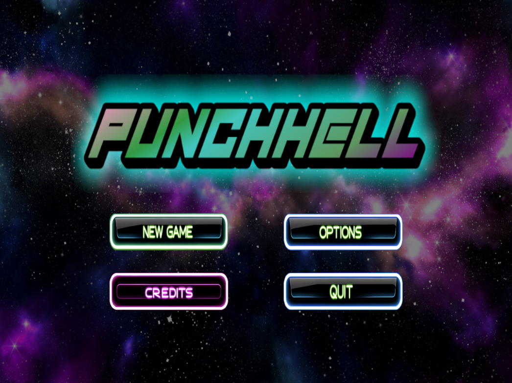
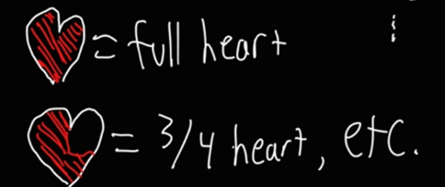
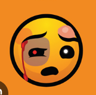
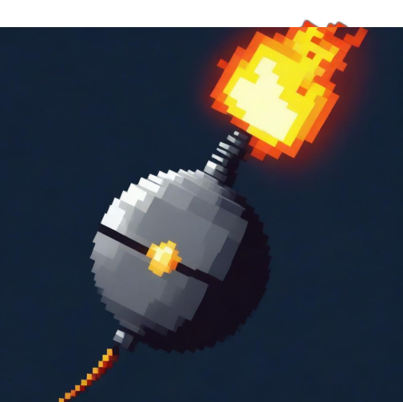
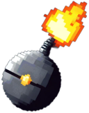
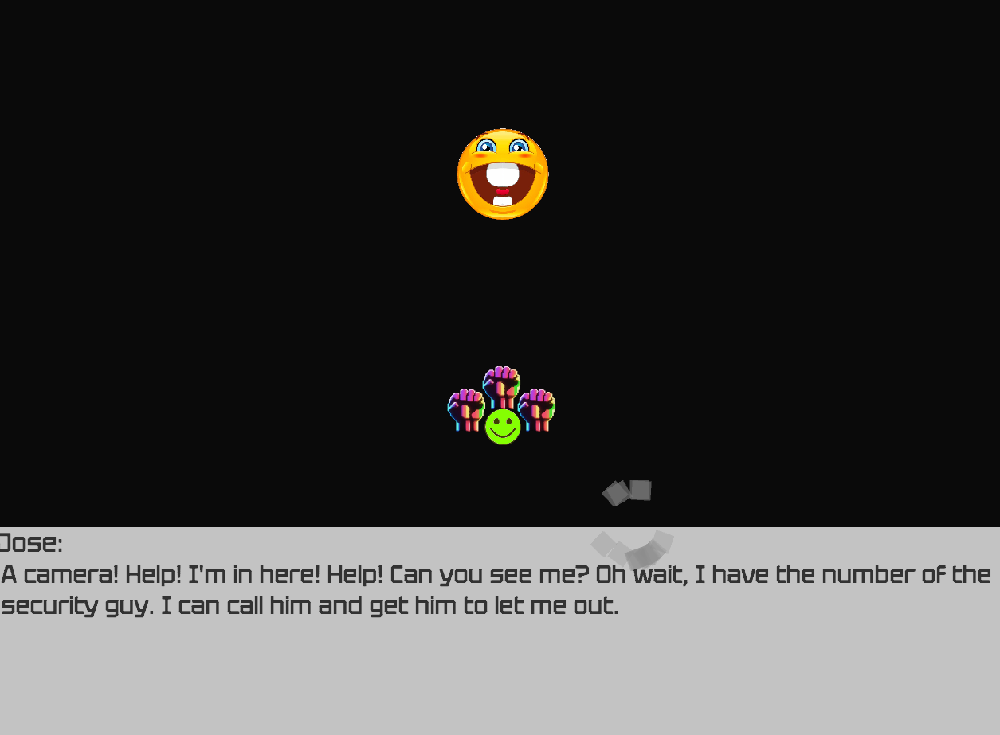
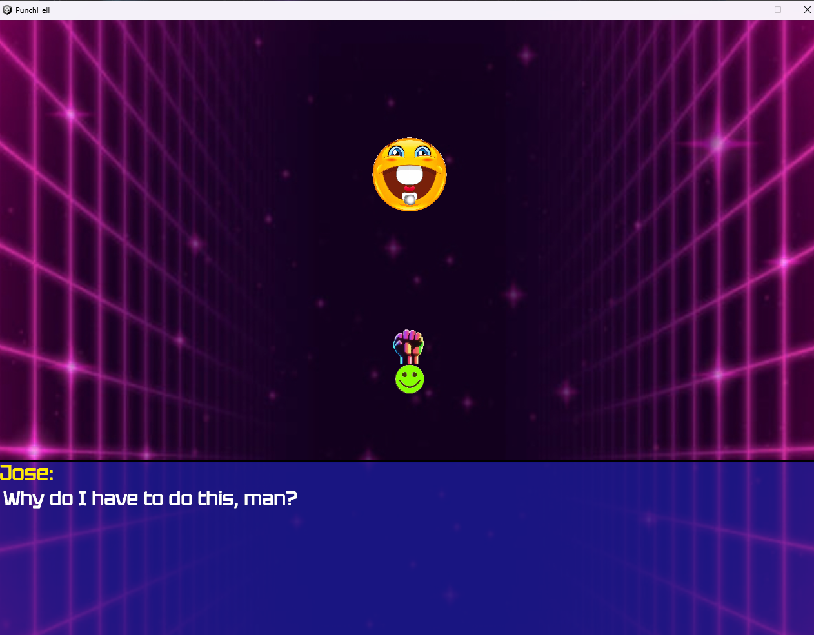
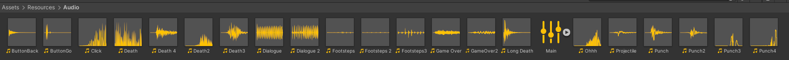
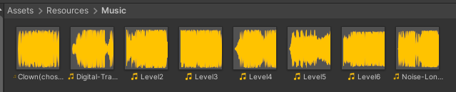

## Summary

PunchHell is a Touhou-style Danmaku (bullet hell) shoot 'em up built in Unity. The player navigates a vertically scrolling stage, dodging complex projectile patterns while destroying waves of enemies with their own projectiles. Across six progressively difficult levels, PunchHell combines tight mechanical gameplay with a lighthearted narrative and a neon-retro aesthetic inspired by 1980s sci-fi.

## Gameplay Explanation

The gameplay follows traditional Danmaku conventions. The player moves with directional keys:

- W: Move up
- A: Move left
- S: Move down
- D: Move right
- ESC: Pause game

As in many bullet hell games, several gameplay elements change how the player moves and interacts with the stage:

- *Player Shoot*; Input: Fire1/LClick. The player fires projectiles from a turret. There can be multiple turrets, as described in the Power section. Player bullets damage enemy units, which have a limited amount of health. A subtle turret sound plays every time the player fires.

- *Score*. A score counter is displayed on the bottom left corner of the screen and increases under the following conditions: an enemy is killed (and subsequently having their on-screen bullets converted to a point drop), a bullet is grazed, or a blue point drop is collected.

- *Power*. The player starts with one stream of projectiles. Two additional turrets can be acquired by collecting red power-ups dropped by enemies. Power-ups fill a meter, and when the meter is full, another turret spawns, up to a maximum of 3.

- *Precise Movement*; Input: Fire2/RClick. At normal movement speed, macro dodging of bullets is straightforward. When patterns become complex and space is limited, the player can switch to slow movement mode. In this mode, movement speed decreases and a precise hitbox becomes visible to facilitate micro dodging.

- *Life*. The player has a fixed number of lives, lost upon contact with bullets. If no lives remain, the game ends. After death, a short invincibility period prevents chain deaths. A hit sound effect and a scream indicate the invincibility window.

- *Graze*. When dodging bullets, there are two hitboxes: the core hitbox (contact kills the player) and the graze hitbox (adds to score for every bullet that remains in contact). This mechanic also fills the Roll Meter.

- *Roll*; Input: SPACE. The player can Roll to gain a short period of invincibility and increased movement speed. Rolling is only available when the Roll Meter (displayed as a white bar on the HUD) is full. The Roll Meter fills through grazing bullets. A sound effect plays during the roll to indicate invincibility.

# Main Roles

## Producer — Konsing Ham Lopez

Managed project logistics including compiling progress reports, aggregating team contributions, and maintaining the GitHub repository. This included resolving Git-related challenges and coordinating across team members with varying schedules.

Beyond production responsibilities, contributed hands-on work in image editing, crafting menu buttons and backgrounds, and programming sound effects/music sliders, toggles, and the Quit Script. This included ensuring these elements persisted correctly across game sessions.



Also contributed to the design of enemy movement patterns in levels 2–6, building on the gameplay structure established in the first level.

## User Interface and Input — Ahmed Irtija

The UI was designed to immerse the player in the game's retro sci-fi atmosphere from the moment they launch. The [main menu](https://github.com/Konsing/ECS-179-Final-Project/blob/241156e60e15781521d02f81b1f8f216634f0bd9/PunchHell/Assets/Scripts/PunchHell/Menu/MainMenu.cs#L6C1-L17C2) features New Game, Options, Credits, and Quit Game buttons against a galaxy-themed background. New Game opens the [level panel](https://github.com/Konsing/ECS-179-Final-Project/blob/4816c7c7b91c301848dff1db292c6193b8a926ac/PunchHell/Assets/Scripts/PunchHell/Menu/LevelMenu.cs#L7C1-L28C2), Options provides sound settings, Credits lists the team, and Quit Game exits the application.

A level selector allows players to jump to any of the six levels. Each level has its own enemy types, waypoints, and movement patterns defined in the [stage definitions script](https://github.com/Konsing/ECS-179-Final-Project/blob/4816c7c7b91c301848dff1db292c6193b8a926ac/PunchHell/Assets/Scripts/PunchHell/StageDefinitions.cs#L11C1-L322C2), with difficulty increasing progressively. The [victory](https://github.com/Konsing/ECS-179-Final-Project/blob/4816c7c7b91c301848dff1db292c6193b8a926ac/PunchHell/Assets/Scripts/PunchHell/Menu/VictoryScreen.cs#L7C1-L49C2) and [defeat](https://github.com/Konsing/ECS-179-Final-Project/blob/4816c7c7b91c301848dff1db292c6193b8a926ac/PunchHell/Assets/Scripts/PunchHell/Menu/LoserScreen.cs#L7C1-L40C2) screens offer options for restarting, advancing to the next level, or returning to the main menu.

Collaboration with Dan Le on movement/physics shaped the six unique levels and their distinct movesets. Various bugs were addressed along the way, including level-loading issues, broken restart buttons, and UI panels not transitioning properly.

The game targets PC with keyboard and mouse input:

- **WASD:** Movement
- **Fire 1 (left click):** Shoot
- **Fire 2 (right click):** Precise/slow movement
- **Space:** Roll
- **ESC:** Pause

## Movement/Physics — Dan Le

Player and enemy movement bypasses Unity's physics system entirely. Player movement modifies the player's transform position directly in the update loop based on input. Enemy movement works similarly, using a waypoint system: each enemy has a list of (x, y) positions, and moves between them every frame via `Vector3.MoveTowards`. Each waypoint specifies a movement speed and a dwell time at the destination.

The exception is enemy drops. Power-ups, point drops, and bullet point drops (all enemy projectiles convert to these when the enemy dies) use `Rigidbody2D` for more organic movement. Bullet point drops home toward the player using physics.

Projectile movement is handled by the [DanmakU library](https://github.com/james7132/DanmakU), which provides efficient creation and management of projectiles with parameters for speed, direction, and angular speed. Patterns are composable — a line of bullets can be composed into a ring, arc, or circle of lines, and so on. DanmakU handles bullet rendering, movement, and collision without Unity GameObjects, using the Unity Jobs system and near-native code for performance. Collision detection uses `Physics.CircleCastNonAlloc` against collider bounding boxes.

**Third-Party Code** — Rather than building a full Danmaku engine from scratch or using the heavyweight "danmokou" engine, the team chose DanmakU for its lightweight, composable approach to bullet pattern generation. While this provided significant time savings and performance benefits through the Unity Jobs system, it also introduced challenges: limited documentation required reading the library source code, and some rendering bugs had to be patched directly. [DanmakU in our project](https://github.com/Konsing/ECS-179-Final-Project/tree/main/PunchHell/Assets/Scripts/DanmakU/Runtime). [DanmakU on GitHub](https://github.com/james7132/DanmakU)

## Animation and Visuals — Jack Sangiamputtakoon

**Assets:**
- [Layer AI](https://www.layer.ai/) — Image generation
- [Krita](https://krita.org/en/) — Image editing

**Visual Style**

The art direction targets a neon, pixelated 16-bit look consistent with the 1980s sci-fi theme. Sprites were generated with Layer AI and then refined in Krita. Design references from the gameplay designer were used as starting points — for example, the health system went from sketch:



to implementation:


Some designs followed references closely, while others took more creative liberty:

 

AI-generated images often required significant touch-up work. For instance, the bomb sprite before and after manual editing:





All sprites were standardized to consistent sizes (e.g., all projectiles at 128×128 pixels) to streamline integration on the gameplay side.

**Animation System**

Given the nature of the shoot 'em up genre, animation was minimal — mostly simple transitional frames. For example, the laser animation progresses from low to full strength:

  

On the code side, background changes were planned to reflect story/dialogue segments dynamically. Since dialogue cutscenes are composed of a [list of stage actions](https://github.com/Konsing/ECS-179-Final-Project/blob/b9cfea731508f81643b75b976a47c43e6dd59c0c/PunchHell/Assets/Scripts/PunchHell/StageDefinitions.cs#L35), scene changes also needed to be stage actions. A `StageActionSetBackground` class was created:

```csharp
public class StageActionSetBackground : StageAction
{
    public GameObject shownBackground;
    public GameObject hidden1;
    public GameObject hidden2;
    public StageActionSetBackground(GameObject shownBackground, GameObject hidden1, GameObject hidden2)
    {
        this.shownBackground = shownBackground;
        this.hidden1 = hidden1;
        this.hidden2 = hidden2;
        this.shownBackground.SetActive(true);
        this.hidden1.SetActive(false);
        this.hidden2.SetActive(false);
    }
}
```

The planned dynamic transitions were ultimately replaced with random background selection per level, which still provides visual variety between stages.

The dialogue boxes were also redesigned — the original opaque boxes obscured too much of the background:



They were replaced with semi-transparent boxes, and [text colors were differentiated](https://github.com/Konsing/ECS-179-Final-Project/blob/63b9e65665dd5503fc1acc16574fd3418e182ffc/PunchHell/Assets/Scripts/PunchHell/DialogueBoxController.cs#L17) between speaker names and dialogue content for readability:



## Game Logic — Dan Le

UI game state is managed through scene separation and UI GameObject visibility toggling. The title screen lives in its own scene, while the playing stage state is centralized in the `StageManager` class.

`StageManager` tracks parameters including lives remaining, score, power level, roll level, invincibility time, roll time, and stage progress. State changes are handled through C# property getters and setters — for example, setting `StageManager.Instance.Level = 1` automatically updates all dependent state for that level. When `LivesRemaining` reaches 0, the game over UI is shown. When `Paused` is toggled via input, the game freezes/unfreezes and the pause menu appears.

Stage progression is managed by `StageActionManager`, which maintains a list of `StageAction` objects and a coroutine that iterates through them. Since C# lacks discriminated unions, the pattern is emulated with an abstract `StageAction` base class and concrete subclasses (`StageSpawnAction`, `StageDialogueAction`, etc.). The coroutine checks each action's type and executes accordingly — spawning enemies, inserting delays, triggering dialogue (which freezes progression until dismissed), or waiting for all enemies to be cleared.

Projectiles are managed by DanmakU. Since documentation was sparse, interfacing with the library required reading its source code. Collision is handled via an Event pattern — `DanmakuCollider` emits events captured by the parent GameObject. Several rendering bugs in the library had to be patched. Collision filtering by layer was not built in, so bullet "Pool" comparison was used to ensure enemies are only damaged by player bullets.

Two key singletons provide global access: `StageManager.Instance` for stage state and `PlayerController.Instance` for player state.

**Design Patterns:**
- **Singleton** — [PlayerController](https://github.com/Konsing/ECS-179-Final-Project/blob/main/PunchHell/Assets/Scripts/PunchHell/PlayerController.cs) and [StageManager](https://github.com/Konsing/ECS-179-Final-Project/blob/main/PunchHell/Assets/Scripts/PunchHell/StageManager.cs)
- **Tagged union via inheritance** — [StageActionManager](https://github.com/Konsing/ECS-179-Final-Project/blob/main/PunchHell/Assets/Scripts/PunchHell/StageActionManager.cs) and its asynchronous action queue
- **Interface abstraction** — [IWaypoint](https://github.com/Konsing/ECS-179-Final-Project/blob/main/PunchHell/Assets/Scripts/PunchHell/Waypoint/IWaypoint.cs) allows both editor-editable `WaypointObject` and code-instantiated `Waypoint` data classes
- **Observer/Event** — Consuming [DanmakuCollider events](https://github.com/Konsing/ECS-179-Final-Project/blob/main/PunchHell/Assets/Scripts/PunchHell/GrazeHitboxController.cs)

**Unrealized Feature: Stage DSL** — A Domain Specific Language for stage scripting was planned to avoid the slow Unity domain reload cycle caused by C# code changes. The idea was a concise scripting format:

```
DialogueAction("Name", "Some dialogue")
SpawnEnemy(EnemyA, (400, 1320), Waypoints1)
Wait(1)
SpawnEnemyWave(EnemyA, (400, 1320), Waypoints2)
```

Instead, stages are defined directly in C#:

```csharp
private static List<StageAction> GetLevel1()
    {
        var enemyAWaypoints = new List<IWaypoint>
        {
                Waypoint.FromCameraPercent(250, 90.0f, 90.0f),
                Waypoint.FromCameraPercent(250, 75.0f, 90.0f),
                Waypoint.FromCameraPercent(250, 40.0f, 70.0f),
                Waypoint.FromCameraPercent(250, 20.0f, 60.0f),
                Waypoint.FromCameraPercent(250, 50.0f, 65.0f)
        };

        return new List<StageAction>
        {
                new StageActionSpawn("Enemies/EnemyBase", new Vector3(640, 720, 0)),
                new StageActionDialogue("Player", "I am so sick and tired of this shit"),
                new StageActionDialogue("Enemy", "Me too dude"),
                new StageActionDelay(5.0f),
                new StageActionSpawn("Enemies/EnemyA", new Vector3(1100, 1100, 0), enemyAWaypoints),
                new StageActionDelay(2.5f),
                new StageActionSpawn("Enemies/EnemyA", new Vector3(1100, 1100, 0), enemyAWaypoints),
                new StageActionDelay(2.5f),
                new StageActionSpawn("Enemies/EnemyA", new Vector3(1100, 1100, 0), enemyAWaypoints),
                new StageActionDelay(2.5f),
                new StageActionWaitForClear()
        };
    }
```

A visual editor tool for defining waypoint paths by dragging on-screen was also considered but not implemented.

## Gameplay Design — Zachary Van Vorst

Zachary served as the primary gameplay and creative designer, responsible for conceiving the game's enemies, attack patterns, level layouts, abilities, menus, sprites, and overall design direction. He provided reference material, sprite concepts, background examples, font/visual theme guidelines, and audio direction for the rest of the team to work from.

**In-game contributions include:**

Dialogue scripting for all six missions:
- [Mission 1](https://github.com/Konsing/ECS-179-Final-Project/blob/18c2420411d5870f3837934bc36b88224158934b/PunchHell/Assets/Scripts/PunchHell/StageDefinitions.cs#L33), [Mission 2](https://github.com/Konsing/ECS-179-Final-Project/blob/18c2420411d5870f3837934bc36b88224158934b/PunchHell/Assets/Scripts/PunchHell/StageDefinitions.cs#L84), [Mission 3](https://github.com/Konsing/ECS-179-Final-Project/blob/18c2420411d5870f3837934bc36b88224158934b/PunchHell/Assets/Scripts/PunchHell/StageDefinitions.cs#L125), [Mission 4](https://github.com/Konsing/ECS-179-Final-Project/blob/18c2420411d5870f3837934bc36b88224158934b/PunchHell/Assets/Scripts/PunchHell/StageDefinitions.cs#L161), [Mission 5](https://github.com/Konsing/ECS-179-Final-Project/blob/18c2420411d5870f3837934bc36b88224158934b/PunchHell/Assets/Scripts/PunchHell/StageDefinitions.cs#L174), [Mission 6](https://github.com/Konsing/ECS-179-Final-Project/blob/18c2420411d5870f3837934bc36b88224158934b/PunchHell/Assets/Scripts/PunchHell/StageDefinitions.cs#L189)

**Design documents and references:**

- [Menus](https://github.com/Konsing/ECS-179-Final-Project/tree/main/PunchHell/Documents/Menus)
- [Gameplay UI Examples](https://github.com/Konsing/ECS-179-Final-Project/tree/main/PunchHell/Documents/Gameplay%20UI%20examples)
- [Dialogue Exchange Design](https://github.com/Konsing/ECS-179-Final-Project/tree/main/PunchHell/Documents/Dialogue%20Exchange%20Design)
- [Buttons](https://github.com/Konsing/ECS-179-Final-Project/tree/main/PunchHell/Documents/Buttons)
- [Player Sprite](https://github.com/Konsing/ECS-179-Final-Project/tree/main/PunchHell/Documents/Player)

**Early design work:**

- [Story sketch](https://github.com/Konsing/ECS-179-Final-Project/blob/main/Documents/Story.pdf)
- [Gameplay mechanics sketch](https://github.com/Konsing/ECS-179-Final-Project/blob/main/Documents/179_Gameplay_240229_155625.pdf)
- [Initial story and level designs](https://docs.google.com/document/d/1p2P99ieAFLnA-otmrhpaOJq8ouLhLcdBULgW5sqo8cI/edit?usp=sharing)
- [Enemy design and projectile patterns](https://github.com/Konsing/ECS-179-Final-Project/blob/main/Documents/MechanicsDraft/Boss%20and%20Enemy%20Variants.pdf)

**Revised/simplified designs:**

As development progressed, the scope was narrowed to focus on core gameplay. Zachary revised the designs accordingly, simplifying the story, enemy types, and level structure:

- [Simplified story](https://github.com/Konsing/ECS-179-Final-Project/tree/main/PunchHell/Documents/Plot)
- [Enemy sprites](https://github.com/Konsing/ECS-179-Final-Project/tree/main/PunchHell/Documents/Enemies)
- [Attack pattern references](https://github.com/Konsing/ECS-179-Final-Project/blob/main/PunchHell/Documents/Enemies/Bosses/Pinwheel%20attack.mp4)
- [Level design](https://github.com/Konsing/ECS-179-Final-Project/tree/main/PunchHell/Documents/Mission%20Level%20Design)
- [Background images](https://github.com/Konsing/ECS-179-Final-Project/blob/main/PunchHell/Documents/Menus/background%20example.png)
- [Projectile design](https://github.com/Konsing/ECS-179-Final-Project/blob/main/PunchHell/Documents/Projectiles%20and%20Projectile%20Mechanics/Normal/Screenshot%202024-03-10%20212822.png)

Additional design documents can be found in the [Documents directory](https://github.com/Konsing/ECS-179-Final-Project/tree/main/PunchHell/Documents).

# Sub-Roles

## Audio — Konsing Ham Lopez

Sound effects and music were curated to match PunchHell's fast-paced, futuristic atmosphere. SFX were sourced from Freesound.org and Pixabay, covering ship engines, weapon fire, hits, rolls, and UI interactions. Music was collected from Pixabay and Free Music Archive — all tracks in a cyberpunk style with high-energy, futuristic tones.





Volume sliders and toggles for music and SFX were implemented through the `VolumeSettings.cs` script, connected to a sound mixer named "Main" that controls every audio source in the game. Adjusting the sliders dynamically alters audio levels across all levels and the title screen. SFX coverage includes button presses, player hit, invincibility duration, roll sounds, and Game Over/Victory effects.


A dedicated sound effects player script manages three distinct button sounds in the main menu for responsive interactions. The `VolumeSettings` script handles all toggles and sliders. Changes were also made to `StageManager.cs` for level-based song transitions and to `PlayerController.cs` for turret firing sounds. The relevant audio/input integration in `PlayerController`:

```csharp
    void Start()
    {
        Instance = this;

        rollSprite = transform.Find("RollPipe");
        bulletEmitters = GetComponentsInChildren<PlayerDanmakuEmitter>(true);
        sprites = GetComponentsInChildren<SpriteRenderer>(true);

        audioSource = GetComponent<AudioSource>();

        ResetPlayerState();
    }

    void Update()
    {
        bool isShooting = Input.GetButton("Fire1");
        if (isShooting && !StageManager.Instance.DialogueActive)
        {
            if (!shootingAudioSource.isPlaying)
                shootingAudioSource.Play();

            foreach (var emitter in bulletEmitters)
                emitter.EnableFiring();
        }
        else
        {
            if (shootingAudioSource.isPlaying)
                shootingAudioSource.Stop();

            foreach (var emitter in bulletEmitters)
                emitter.DisableFiring();
        }
        
        if (Input.GetKeyDown(KeyCode.Escape) && !StageManager.Instance.DialogueActive)
            StageManager.Instance.Paused = !StageManager.Instance.Paused;

        if (Input.GetKeyDown(KeyCode.Space) && StageManager.Instance.RollLevel >= 100)
        {
            StageManager.Instance.AddRoll(-StageManager.Instance.RollLevel);
            rollTimeRemaining = rollTimeMax;

            rollAudioSource.Play();
        }

        if (rollTimeRemaining <= 0.0f)
        {
            if (rollAudioSource.isPlaying)
            {
                rollAudioSource.Stop();
            }

            transform.rotation = new Quaternion(0, 0, 0, 0);
            rollSprite.gameObject.SetActive(false);
        }
        else
        {
            Debug.Log((rollTimeMax - rollTimeRemaining) / rollTimeMax);
            transform.Rotate(new Vector3(0, 0, 360 / rollTimeMax * Time.deltaTime));
            rollSprite.gameObject.SetActive(true);
        }

        rollTimeRemaining = Mathf.Max(0.0f, rollTimeRemaining -= Time.deltaTime);
        invincibilityRemaining = Mathf.Max(0.0f, invincibilityRemaining -= Time.deltaTime);

        var slowMove = Input.GetButton("Fire2");

        transform.Find("Hitbox").GetComponent<SpriteRenderer>().enabled = slowMove;

        var speed = slowMove ? slowMoveSpeed : (rollTimeRemaining > 0.0f ? rollMoveSpeed : moveSpeed);

        Vector3 movement = new Vector3(Input.GetAxisRaw("Horizontal"), Input.GetAxisRaw("Vertical"), 0).normalized;
        gameObject.transform.position += movement * speed * Time.deltaTime;

        var cameraBounds = Camera.main.OrthographicBounds();

        gameObject.transform.position = new Vector3(
            Mathf.Clamp(transform.position.x, cameraBounds.min.x, cameraBounds.max.x),
            Mathf.Clamp(transform.position.y, cameraBounds.min.y, cameraBounds.max.y),
            transform.position.z);

        foreach (var emitter in bulletEmitters)
        {
            if (Input.GetButton("Fire1"))
                emitter.EnableFiring();
            else
                emitter.DisableFiring();
        }

        if (invincibilityRemaining > 0)
        {
            if (!audioSource.isPlaying)
            {
                audioSource.clip = hitSound;
                audioSource.loop = true;
                audioSource.Play();
            }
        }
        else
        {
            if (audioSource.isPlaying && audioSource.clip == hitSound)
            {
                audioSource.Stop();
            }
        }
    }

    void Die()
    {
        StageManager.Instance.LivesRemaining -= 1;
        invincibilityRemaining = invincibilityTimeAfterDeath;

        audioSource.PlayOneShot(deathSound);
    }
```

An early issue where music only played on restart/new game was resolved by updating the initialization in `StageManager`. The stage manager holds all six tracks and transitions between them based on the current level.

 

 


## Gameplay Testing

Playtester feedback was surprisingly positive, with many testers unfamiliar with the bullet hell genre finding its mechanics and chaotic visuals engaging. The primary finding was that the game was very difficult — expected for a bullet hell, but steep enough to discourage new players from replaying. In response, the first two levels were made easier to provide a sense of progression for beginners.

Testers also frequently did not notice when they took damage, so hit feedback was made more prominent. Additionally, since game mechanics were not as self-explanatory as hoped, a short "how to play" tutorial was added to the beginning of the game.

## Narrative Design — Zachary Van Vorst

The narrative went through several iterations, evolving from an elaborate plot to a streamlined story that better fit the game's scope. Early concepts centered on a high schooler dealing with a corrupt corporation; the final version takes a more comedic tone.

- [Initial story sketch](https://github.com/Konsing/ECS-179-Final-Project/blob/main/Documents/Story.pdf)
- [Near-final draft](https://docs.google.com/document/d/1p2P99ieAFLnA-otmrhpaOJq8ouLhLcdBULgW5sqo8cI/edit?usp=sharing)

**Final Story**

The narrative follows Jose, a janitor working for the villainous "Boss Boss," who one day receives an unexpected promotion to commander of an army of boxer robots. The robots immediately malfunction when Boss Boss spills coffee on the control panel. Jose must fight through six missions of rogue robots and hostile corporate employees, ultimately defeating Boss Boss himself — only to face one final challenger.

Each mission opens with a dialogue segment that advances the story, presented with backgrounds, character names, and music. As missions progress, enemy behavior becomes more aggressive and technically complex.

- [Dialogue box](https://github.com/Konsing/ECS-179-Final-Project/blob/main/Documents/Screenshot%202024-03-22%20154617.png)
- [Original layout design](https://github.com/Konsing/ECS-179-Final-Project/blob/main/PunchHell/Documents/Dialogue%20Exchange%20Design/Screenshot%202024-03-11%20154457.png)
- [Plot documents by mission](https://github.com/Konsing/ECS-179-Final-Project/tree/main/PunchHell/Documents/Plot)
- [Robotic enemy style](https://github.com/Konsing/ECS-179-Final-Project/blob/main/PunchHell/Documents/Enemies/Basic/Screenshot%202024-03-10%20210358.png)
- [Neon font and button style](https://github.com/Konsing/ECS-179-Final-Project/blob/main/PressKit/PunchHell.png)
- [Gameplay screenshot](https://github.com/Konsing/ECS-179-Final-Project/blob/main/PunchHell/Documents/Screenshot%202024-03-22%20160300.png)

Projectiles are shaped like punches to reinforce the theme of Jose fighting for survival.

**Implementation Details**

Each mission contains a Dialogue canvas with `DialogueText`, `DialogueName`, and `DialogueSounds` components. Clicking the mouse advances to the next dialogue segment; when all segments are exhausted, the mission starts. The font is Tektur-Regular at size 16, with `DialogueName` rendered bold at size 32 for visual distinction.

A tutorial segment was added to Mission 1 to introduce controls, objectives, and the basic gameplay loop to new players.

## Game Feel and Polish — Ahmed Irtija

Game feel was refined through iterative playtesting of each feature as it was added. Key improvements included:

- **Menu flow** — Restart options were added to both the defeat and victory screens so players can immediately jump back into the action. A "New Game" button provides a quick way to reset all level progress.

- **Difficulty tuning** — Enemy prefabs were adjusted — health values, movement patterns, and spawn configurations — to create a more balanced difficulty curve. Each adjustment was playtested to verify the impact on engagement and challenge.

- **Overall polish** — Elements were systematically tested and tweaked to ensure changes improved both visual presentation and playability, resulting in a more cohesive and rewarding experience.
